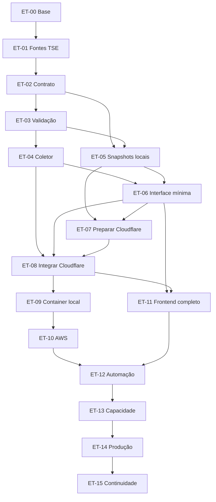

# Planejamento de desenvolvimento

[Voltar ao contexto](../contexto.md)

Este documento organiza a sequência de desenvolvimento do eleicoes-2026. O estado de cada etapa fica só no [catálogo](etapas/README.md). Os documentos individuais ainda não existem. O prompt que deve criá-los está em [prompts/gerar-documentacao-das-etapas.md](prompts/gerar-documentacao-das-etapas.md) e não foi executado nesta sessão.

Os rótulos de estado do projeto estão em [contexto.md](../contexto.md). Uma decisão adotada não é implementação. Um arquivo no repositório não é funcionalidade testada. Um desenho de nuvem não é recurso provisionado, e recurso provisionado não é recurso validado.

## A. Objetivo e limites

O planejamento cobre a primeira versão: acompanhar os resultados oficiais do segundo turno de 2026, com visão presidencial nacional, resultado presidencial por unidade da Federação, governador só onde a configuração oficial confirmar a disputa, mapa interativo, atualização periódica e exibição clara de ausência e de desatualização. Liderança parcial não equivale a confirmação de eleição.

O caminho de resultados é o já adotado:

```text
TSE → collector → validação e normalização → snapshots JSON → Cloudflare R2 e CDN → frontend
```

O caminho do site é o já adotado:

```text
React + Vite → build estático → Cloudflare Workers Static Assets → navegador
```

O desenvolvimento começa na máquina local. A Cloudflare entra antes de transferir a execução contínua do coletor para a AWS. O mapa completo não precisa existir para essa validação. A primeira versão tem um publicador ativo. O coletor pode publicar no R2 a partir do computador antes de ir para a AWS.

Ficam fora da primeira versão, e fora desta sequência: `apps/api` com NestJS e Fastify, PostgreSQL, Redis, load balancer próprio, SSE, WebSocket, filas e função Worker no meio da leitura dos JSON. Os critérios para reconsiderar isso estão na [seção H](#h-evoluções-condicionais).

Também ficam fora: Senado, deputados, eleições municipais, cadastro de visitante, projeção e declaração própria de vencedor. Listas de candidatos, de unidades com segundo turno e códigos eleitorais não entram como dado confirmado. Isso se resolve na etapa da integração eleitoral, com a configuração oficial vigente.

## B. Estado observado do projeto

Inspeção de arquivos em 15 de outubro de 2026. Os comandos de build, lint e teste não foram executados nesta sessão. O que o [README](../../README.md) e o [contexto](../contexto.md) afirmam sobre esses comandos permanece como documentação anterior, de 14 de outubro de 2026, não como nova evidência de execução.

### O que existe

| Evidência | O que se pode afirmar |
| --- | --- |
| [README.md](../../README.md), [package.json](../../package.json), [pnpm-workspace.yaml](../../pnpm-workspace.yaml), [.nvmrc](../../.nvmrc) | Monorepositório com pnpm 12.11.2, Node.js 24.22.0 e workspaces `apps/*` e `packages/*`. Scripts de raiz: `dev:web`, `dev:collector`, `build`, `typecheck`, `lint`, `format`, `format:check`, `test` |
| [apps/web](../../apps/web/package.json), [apps/web/src/App.tsx](../../apps/web/src/App.tsx) | React 19.3.1, Vite 8.3.4 e Tailwind CSS 4.3.3. A tela mostra o título "Eleições 2026 — ambiente inicial" |
| [apps/collector/src/index.ts](../../apps/collector/src/index.ts), [apps/collector/package.json](../../apps/collector/package.json) | Ponto de entrada que registra a ausência da integração com o TSE. Desenvolvimento com `tsx`; `start` aponta para `dist/index.js` |
| [packages/types/src/index.ts](../../packages/types/src/index.ts), [packages/election-data/src/index.ts](../../packages/election-data/src/index.ts), [packages/validation/src/index.ts](../../packages/validation/src/index.ts) | Três pacotes com export vazio. Zod 4.6.7 está em `@eleicoes/validation`. Nenhum `package.json` de aplicativo depende de outro pacote do workspace |
| [apps/web/.env.example](../../apps/web/.env.example), [apps/collector/.env.example](../../apps/collector/.env.example), [.gitignore](../../.gitignore) | Exemplos sem variáveis. `.env` e `.env.*` estão ignorados, com exceção de `.env.example` |
| `docs/` | Contexto, arquitetura, dados, infraestrutura, segurança, testes, padrões, API, coletor e web. Índices em cada pasta |
| `apps/api/.gitkeep`, `tests/load/.gitkeep`, `infra/cloudflare/.gitkeep`, `.github/workflows/.gitkeep` | Pastas reservadas |

Não há `AGENTS.md` nem arquivos em `.cursor/rules/`. Essa ausência já estava registrada no contexto e foi conferida de novo nesta sessão.

### O que está apenas documentado

Arquitetura, contrato conceitual, ordem de infraestrutura, controles de segurança, matriz de testes e padrões de código. Workers Static Assets, R2, CDN, EC2 e Docker estão decididos como destino e não existem como recurso. Não há schema, amostra, cliente HTTP, manifesto, Dockerfile, Wrangler, workflow nem script de carga.

### O que não foi verificado

- Sucesso atual de `pnpm build`, `pnpm typecheck`, `pnpm lint`, `pnpm format:check` e `pnpm test`.
- Qualquer publicação, cache, CORS, grupo de segurança ou reinício em nuvem.
- PDFs de especificação do TSE, manual de verificação JWS e artigos 264 a 269 da Resolução TSE nº 23.751/2026. [dados/README.md](../dados/README.md) já declara que essas leituras não foram feitas.
- Comportamento do host de simulado depois da janela de setembro de 2026.

`pnpm test` está definido com `--passWithNoTests`. Enquanto não houver arquivos de teste, uma execução bem-sucedida desse comando não prova suíte.

### Lacunas que afetam o início

| Lacuna | Efeito |
| --- | --- |
| Campos, tipos e amostras de EA11, EA14, EA15 e EA20 ainda não fechados | ET-03 não tem schema real para escrever. ET-04 não tem URL confirmada para consultar |
| Contrato ainda conceitual; `latest.json` é proposta | ET-02 precisa fechar versão, manifesto e semântica antes da publicação |
| JWS e artigos 264 a 269 não lidos | Se o manual exigir verificação, a publicação de homologação espera. A exposição pública espera a leitura da resolução |
| Domínios, plano, orçamento, TTLs, intervalos e metas numéricas sem valor | Etapas de nuvem, carga e produção podem ser preparadas e não podem ser anunciadas como capacidade |
| Fonte do GeoJSON pendente | O mapa de ET-11 espera essa escolha. A tela mínima de ET-06 não espera |
| Lista de governadores no segundo turno | Só a configuração oficial vigente autoriza o painel. Não há lista neste repositório |

### Divergências e decisão vigente

O [README](../../README.md) ainda associa `infra/cloudflare` a Cloudflare Pages e lista Pages entre os itens adiados. A decisão vigente, em [contexto.md](../contexto.md), [arquitetura/README.md](../arquitetura/README.md) e [infraestrutura/README.md](../infraestrutura/README.md), é Workers Static Assets. CDN e R2 continuam. Pages não é destino. O README da raiz não foi alterado nesta sessão.

[infraestrutura/README.md](../infraestrutura/README.md) descreve dez passos. [collector/README.md](../collector/README.md) descreve seis. Este planejamento usa ET-00 a ET-15. É decomposição da mesma ordem local → Cloudflare → AWS → produto → validação operacional. Não há segunda arquitetura aprovada.

A administração da instância por Session Manager está como proposta em [infraestrutura/README.md](../infraestrutura/README.md) e [seguranca/README.md](../seguranca/README.md). Não está adotada como recurso. ET-10 fecha esse acesso antes de operar a máquina.

## C. Estratégia de implementação

A progressão abaixo é a do produto. Código de regra entra cedo, com teste unitário. Nuvem entra depois que o fluxo local prova validação, versão e leitura. Operação contínua na AWS entra depois que a Cloudflare já entrega site e snapshots.

1. **Validar a interpretação dos dados.** ET-00 confirma a base e o que já não precisa ser refeito. ET-01 obtém evidência controlada das fontes. ET-02 fecha o contrato e a política de snapshots com essa evidência.
2. **Construir um fluxo mínimo local.** ET-03 implementa validação e normalização com testes. ET-04 implementa o coletor. ET-05 grava versões em disco. ET-06 mostra um painel mínimo lendo esses arquivos. O mapa final não faz parte desse fluxo.
3. **Conectar a Cloudflare.** ET-07 prepara Workers Static Assets, R2, domínios, cache, proteção básica e controle inicial de custo. ET-08 faz o coletor local publicar no R2 e o frontend de homologação ler o domínio próprio.
4. **Preparar e operar o coletor na AWS.** ET-09 empacota e recupera o processo em container, ainda na máquina. ET-10 sobe EC2 e tira a execução contínua do computador.
5. **Completar a experiência do site.** ET-11 entrega mapa, seleção, painéis, polling, acessibilidade, responsividade e os estados de indisponibilidade e desatualização.
6. **Consolidar automação e operação.** ET-12 reúne CI/CD, monitoramento, alertas, publicação, retorno de versão e gestão de credenciais. Proteção básica e log mínimo não esperam esta etapa.
7. **Validar capacidade e recuperação.** ET-13 ensaia na homologação os cenários definidos, lê custo e prova falha e retorno. Aprovação local não substitui essa prova.
8. **Publicar e acompanhar a produção.** ET-14 faz o ensaio e a entrada controlada. ET-15 decide retenção, continuidade ou encerramento, sem apagar dado por omissão.

### Quando entra cada tipo de trabalho

| Pergunta | Resposta neste plano |
| --- | --- |
| Quando entra o código? | Na ET-03, depois que ET-02 tiver um contrato fechado o bastante para schema e transformação. ET-00 e ET-01 são investigação e registro. Elas não reabrem o scaffolding de `apps/web` e `apps/collector` |
| Quando entra a Cloudflare? | Preparação na ET-07 e integração na ET-08, depois do fluxo local e antes da operação contínua na AWS |
| Quando entra a AWS? | Container local na ET-09. Instância e operação contínua na ET-10, depois da publicação de homologação já comprovada a partir do computador |
| O que pode ser testado localmente? | Schema, normalização, ciclo do coletor, publicação em disco, preservação do manifesto, estados da tela mínima e, na ET-09, subida e recuperação do container. A lista está em [testes/README.md](../testes/README.md) |
| O que exige homologação? | Leitura pelo domínio próprio, status de cache, CORS com `Origin`, proteção de borda, caminho alternativo do bucket, coletor na instância, alerta, retorno de versão, carga e custo |
| Como segurança e performance serão verificadas? | No nível que consegue observar o controle, conforme [testes/seguranca.md](../testes/seguranca.md) e [performance.md](../padroes/performance.md). Unidade nas primeiras regras. Homologação para cache, borda e instância. Carga só na ET-13, contra a nossa infraestrutura autorizada, com teto e interrupção escritos antes |
| O que comprova a etapa? | A entrega e o critério de saída da [seção D](#d-etapas-e-dependências). O catálogo separa documentação de implementação |
| O que ainda impede implementação? | A [seção G](#g-riscos-e-decisões-pendentes). Trabalho que não depende da pendência pode avançar |

Três relógios permanecem distintos no contrato: horário informado pela origem, horário de coleta e horário de publicação. Coleta bem-sucedida não prova que a apuração mudou. Consistência dos nossos arquivos também não prova que EA14, EA15 e EA20 nasceram no mesmo instante.

## D. Etapas e dependências

Os identificadores ET-00 a ET-15 são a convenção deste planejamento. O catálogo é a referência de estado. Dependência obrigatória é o que, se faltar, produz retrabalho ou uma entrega que não pode ser verificada. Etapa anterior na lista não é, por si só, dependência.



Trabalho que pode avançar sem esperar a etapa vizinha:

- Decisões de domínio, plano e orçamento podem ser escritas a partir de ET-00, sem criar recurso. A criação dos recursos espera ET-05 e ET-06, para o layout publicado e a tela de ensaio já existirem.
- ET-04 e ET-05 podem ser implementadas em paralelo depois de ET-03. ET-06 só começa quando as duas se encontram: o coletor gera o snapshot e o disco o conserva.
- A escolha da fonte do GeoJSON pode ser investigada junto de ET-01. A implementação do mapa espera ET-06 e a prova na homologação espera ET-08. ET-11 não depende de ET-09 nem de ET-10.
- Um workflow que só executa lint e testes unitários pode nascer quando a primeira suíte existir, na ET-03. ET-12 consolida publicação, alerta e retorno. Não é a primeira vez em que o repositório pode ter verificação automática.
- O texto da decisão de retenção pode ser redigido antes da eleição. Executar desligamento ou exclusão espera ET-14 e uma decisão explícita.

### ET-00 — Verificar a base do projeto e as pendências documentais

| Campo | Conteúdo |
| --- | --- |
| Objetivo | Confirmar inicialização, comandos, padrões e bloqueios, e registrar o que já está pronto para não repetir scaffolding |
| Componentes | Raiz do monorepositório, `apps/web`, `apps/collector`, pacotes, `docs/` |
| Dependências | Nenhuma |
| Entrega | Registro conferido da base, dos comandos executados nesta etapa e das pendências que bloqueiam ET-01 em diante |
| Critério de saída | Cada comando já definido foi executado ou teve a falha registrada. A lista de pendências de [dados/README.md](../dados/README.md) e de [infraestrutura/README.md](../infraestrutura/README.md) está classificada em bloqueante ou não para a etapa seguinte |
| Bloqueios | Nenhum para começar. A etapa não cria conta nem altera código de aplicação |
| Marco | Porta de entrada de M1 |

Documento previsto: `docs/planejamento/etapas/00-base-do-projeto.md`

### ET-01 — Validar as fontes e os dados do TSE

| Campo | Conteúdo |
| --- | --- |
| Objetivo | Investigar de forma controlada, obter amostras identificadas, confirmar identificadores na configuração vigente e mapear os campos necessários |
| Componentes | Origem oficial, `packages/election-data` somente se houver material compartilhado justificado, documentação de dados |
| Dependências | ET-00 |
| Entrega | Mapa de campos com fonte, amostras separadas de dado sintético, e decisão sobre o que ainda impede o contrato |
| Critério de saída | Códigos e caminhos usados dali em diante saem do EA11 vigente e das instruções de 2026. Candidatos e unidades com governador não foram fixados à mão. A necessidade de EA15 e de JWS está classificada |
| Bloqueios | Leitura das especificações, do manual JWS e dos artigos 264 a 269. Disponibilidade do simulado, se o ensaio for usar esse host |
| Marco | M1, junto com ET-02 |

Documento previsto: `docs/planejamento/etapas/01-validacao-dados-tse.md`

### ET-02 — Consolidar o contrato público e a política de snapshots

| Campo | Conteúdo |
| --- | --- |
| Objetivo | Fechar o modelo normalizado, a semântica de atualização, a versão do contrato e as regras de publicação |
| Componentes | Contrato compartilhado, manifesto, snapshots versionados |
| Dependências | ET-01 |
| Entrega | Contrato com versão, grupos fechados até o nível que a evidência permitir, e política distinta de manifesto e de arquivo imutável |
| Critério de saída | Web e coletor têm um documento único do que será publicado. Campo sem evidência permanece pendente e bloqueia só o trecho que depende dele. `latest.json`, se for adotado, deixa de ser apenas proposta |
| Bloqueios | Campo cujo significado a ET-01 não tenha conseguido confirmar. Denominador de percentual, ordenação por IDG e tratamento de retificação, se a especificação ainda não responder |
| Marco | M1 |

Documento previsto: `docs/planejamento/etapas/02-contrato-e-snapshots.md`

### ET-03 — Implementar validação e normalização

| Campo | Conteúdo |
| --- | --- |
| Objetivo | Transformar resposta bruta já delimitada no contrato, recusando corpo inválido, com testes unitários no mesmo passo |
| Componentes | `packages/validation`, `packages/types`, normalização do coletor |
| Dependências | ET-02 |
| Entrega | Schemas, funções de transformação e suíte que cubra ausência, zero, campo extra, tipo inválido e retificação conforme a regra fechada |
| Critério de saída | Os testes da unidade passam e distinguem dado oficial de fixture sintética. Resposta inválida não produz modelo publicável |
| Bloqueios | Contrato ainda aberto no trecho que o schema precisaria inventar |
| Marco | Início de M2 |

Documento previsto: `docs/planejamento/etapas/03-validacao-e-normalizacao.md`

### ET-04 — Implementar o coletor

| Campo | Conteúdo |
| --- | --- |
| Objetivo | Consultar a origem de forma controlada, orquestrar um ciclo, tratar falha e impedir ciclos sobrepostos |
| Componentes | `apps/collector` |
| Dependências | ET-01, ET-03 |
| Entrega | Processo com allowlist, limites, um ciclo por vez e log sem segredo |
| Critério de saída | Consulta de ensaio usa só URL confirmada. Timeout, corpo excedente, redirect de host e bloqueio não viram snapshot. Segundo disparo não corre junto com o primeiro |
| Bloqueios | URL e códigos ainda não confirmados. Valores numéricos de timeout, concorrência e intervalo continuam pendentes: a existência do limite não espera o número final, e o número não pode ser inventado |
| Marco | M2 |

Documento previsto: `docs/planejamento/etapas/04-coletor.md`

### ET-05 — Implementar publicação e snapshots locais

| Campo | Conteúdo |
| --- | --- |
| Objetivo | Gravar versões em disco, com manifesto, conferência do conjunto e preservação do último válido |
| Componentes | Publicação local do coletor |
| Dependências | ET-02, ET-03. O fluxo único com o processo de coleta também exige ET-04 |
| Entrega | Diretório de versões, manifesto e testes de publicação incompleta e de falha no meio da escrita |
| Critério de saída | O manifesto só muda depois do conjunto completo. Falha deixa o ponteiro anterior legível. Erro não ocupa a chave de um resultado |
| Bloqueios | Nome e formato do manifesto, se ET-02 não os tiver fechado |
| Marco | M2 |

Documento previsto: `docs/planejamento/etapas/05-publicacao-e-snapshots-locais.md`

### ET-06 — Construir a primeira interface funcional

| Campo | Conteúdo |
| --- | --- |
| Objetivo | Painel mínimo que consuma snapshots locais e prove o fluxo completo, sem o mapa final |
| Componentes | `apps/web` |
| Dependências | ET-04, ET-05 |
| Entrega | Tela que lê o contrato local e mostra os estados necessários para distinguir ausência, zero e falha |
| Critério de saída | A tela usa o agregado nacional do contrato, omite governador quando o contrato não traz a disputa e não declara vencedor. O build do Vite continua estático |
| Bloqueios | Contrato ou snapshot local ainda inexistente. Fonte do mapa não bloqueia esta etapa |
| Marco | M2 concluído |

Documento previsto: `docs/planejamento/etapas/06-interface-funcional-inicial.md`

### ET-07 — Preparar a homologação na Cloudflare

| Campo | Conteúdo |
| --- | --- |
| Objetivo | Deixar Workers Static Assets, R2, domínios, cache, proteção básica e controles iniciais de custo prontos para ensaio |
| Componentes | Cloudflare, `infra/cloudflare`, build já existente do frontend |
| Dependências | ET-05, ET-06 |
| Entrega | Ambiente de ensaio com site no domínio de homologação, bucket privado ligado a domínio próprio e regras separadas para manifesto e snapshots |
| Critério de saída | O site de ensaio abre. O endereço público dos JSON não é `r2.dev`. Proteção básica está ligada antes da primeira exposição. O custo previsto foi lido na tabela vigente, dentro do orçamento então definido |
| Bloqueios | Domínios, plano da Cloudflare e orçamento. Artigos 264 a 269, antes de expor o ensaio. JWS, se ET-01 concluir que a publicação depende dele |
| Marco | Preparação de M3 |

Documento previsto: `docs/planejamento/etapas/07-homologacao-cloudflare.md`

### ET-08 — Integrar o código à Cloudflare

| Campo | Conteúdo |
| --- | --- |
| Objetivo | Publicar no R2 a partir do coletor local e fazer o frontend de homologação consumir os resultados publicados |
| Componentes | Coletor, R2, frontend de homologação |
| Dependências | ET-04, ET-06, ET-07 |
| Entrega | Uma versão nova visível no domínio próprio sem novo build do frontend |
| Critério de saída | Manifesto e arquivo versionado apresentam os comportamentos de cache definidos. CORS, se as origens diferirem, foi testado com `Origin`. Credencial de homologação não escreve em produção |
| Bloqueios | ET-07 sem domínio próprio ou sem proteção básica. Método de autenticação do R2 ainda em aberto: a etapa escolhe e registra, e não copia segredo para o repositório |
| Marco | M3 |

Documento previsto: `docs/planejamento/etapas/08-integracao-cloudflare.md`

### ET-09 — Containerizar e validar o coletor localmente

| Campo | Conteúdo |
| --- | --- |
| Objetivo | Empacotar o coletor e provar execução, encerramento e recuperação do processo |
| Componentes | Imagem do coletor, configuração, publicação já integrada |
| Dependências | ET-08 |
| Entrega | Imagem que sobe, publica e, depois de encerrada, sobe de novo sem apagar a última versão válida |
| Critério de saída | O mesmo empacotamento usado no ensaio local é o candidato à instância. Segredo não está na imagem. Reinício não publica conjunto vazio |
| Bloqueios | Publicação de homologação ainda não comprovada, para não empacotar um publicador que ainda vá mudar de contrato |
| Marco | Preparação de M4 |

Documento previsto: `docs/planejamento/etapas/09-container-do-coletor.md`

### ET-10 — Preparar a AWS e operar o coletor

| Campo | Conteúdo |
| --- | --- |
| Objetivo | Executar o coletor em EC2, com acesso administrativo, credencial, log, reinício e operação contínua sem o computador |
| Componentes | AWS EC2, Docker, credenciais, logs |
| Dependências | ET-09 |
| Entrega | Instância que publica sozinha no destino de homologação e não serve os JSON ao público |
| Critério de saída | Com a sessão local encerrada, uma versão nova continua aparecendo. Tentativa de leitura pública no endereço da instância não obtém os snapshots. Reinício conserva a versão. Credencial da instância é distinta da usada só no computador |
| Bloqueios | Região, tipo, sistema, mecanismo de segredo e destino dos logs. A proposta de Session Manager precisa ser adotada ou substituída por outra decisão escrita antes de abrir acesso |
| Marco | M4 |

Documento previsto: `docs/planejamento/etapas/10-aws-e-operacao-do-coletor.md`

### ET-11 — Completar o frontend

| Campo | Conteúdo |
| --- | --- |
| Objetivo | Entregar mapa, seleção de UF, painéis, polling, acessibilidade, responsividade e estados de indisponibilidade ou desatualização |
| Componentes | `apps/web` |
| Dependências | ET-06 para implementar; ET-08 para concluir a verificação na homologação. Não depende de ET-09 nem de ET-10 |
| Entrega | Experiência descrita em [web/README.md](../web/README.md), lendo o contrato publicado |
| Critério de saída | Mapa e lista oferecem a mesma escolha. Governador só aparece quando o contrato confirma a disputa. Polling não usa parâmetro aleatório, não sobrepõe pedido e conserva o último quadro na falha. Cor não é o único meio de distinguir seleção ou candidatura |
| Bloqueios | Fonte do GeoJSON. Atraso tolerável do aviso de desatualização, para o limiar visual. Intervalo de polling, que pode ficar explícito como pendente de medição sem impedir o comportamento |
| Marco | M5 |

Documento previsto: `docs/planejamento/etapas/11-frontend-completo.md`

### ET-12 — Consolidar automação e operação

| Campo | Conteúdo |
| --- | --- |
| Objetivo | Reunir CI/CD, monitoramento, alertas, publicação, retorno de versão e gestão de credenciais |
| Componentes | GitHub Actions, operação do coletor, Cloudflare, AWS |
| Dependências | ET-10, ET-11 |
| Entrega | Caminho repetível de verificação e de publicação, com aviso quando o processo cai ou o dado envelhece, e procedimento de retorno do manifesto |
| Critério de saída | Um ensaio dispara o alerta de parada e o de atraso. O retorno a uma versão válida está escrito e foi ensaiado em homologação. Segredo de CI não aparece no log |
| Bloqueios | Canal do alerta, limiar de atraso e destino final dos logs. A etapa não espera esses números para proteger acesso: isso já é obrigação de ET-07 e ET-10 |
| Marco | Preparação de M6 |

Documento previsto: `docs/planejamento/etapas/12-automacao-e-operacao.md`

### ET-13 — Validar capacidade, segurança e resiliência

| Campo | Conteúdo |
| --- | --- |
| Objetivo | Medir homologação, custo, cache, falha, recuperação e os ajustes que essas provas pedirem |
| Componentes | Homologação do site, dos snapshots e do coletor |
| Dependências | ET-12 |
| Entrega | Relato do cenário medido e dos ajustes aplicados, com visitantes simultâneos, requisições por segundo e volume transferido separados |
| Critério de saída | A carga rodou só na infraestrutura autorizada, com teto e interrupção definidos antes. Cache, erro e custo foram lidos durante o ensaio. O roteiro de incidente foi executado. O resultado não é anunciado fora do cenário medido |
| Bloqueios | Orçamento de carga, condição de interrupção e metas ainda sem valor. Sem esses textos, o ensaio não começa |
| Marco | M6 |

Documento previsto: `docs/planejamento/etapas/13-capacidade-seguranca-e-resiliencia.md`

### ET-14 — Preparar e executar a entrada em produção

| Campo | Conteúdo |
| --- | --- |
| Objetivo | Checklist de prontidão, ensaio operacional, publicação controlada, validação e acompanhamento |
| Componentes | Produção do site, do R2 e do coletor |
| Dependências | ET-13 |
| Entrega | Produção no domínio final, com credencial própria, e registro do que foi observado na abertura |
| Critério de saída | O checklist foi cumprido no ambiente de produção, não só copiado da homologação. Oficial e simulado não compartilham prefixo. Há quem acompanhe a primeira janela, com critério de interrupção |
| Bloqueios | Domínio final, credencial de produção, metas de recuperação e aceite do ensaio da ET-13 |
| Marco | Entrada que usa M6 |

Documento previsto: `docs/planejamento/etapas/14-entrada-em-producao.md`

### ET-15 — Planejar continuidade e encerramento operacional

| Campo | Conteúdo |
| --- | --- |
| Objetivo | Definir retenção dos resultados, o que continua ligado e o que será encerrado depois do acompanhamento, com controle de custo |
| Componentes | R2, EC2, Cloudflare, credenciais, operação |
| Dependências | ET-14 para executar desligamento. A decisão de retenção pode ser escrita antes e precisa existir antes de qualquer exclusão |
| Entrega | Decisão explícita do que permanece, por quanto tempo e com qual custo, e execução somente do que essa decisão autorizar |
| Critério de saída | Nenhum dado foi apagado por procedimento automático implícito. Credencial que não tiver mais uso foi revogada ou teve a revogação agendada por escrito. O custo residual está identificado |
| Bloqueios | Decisão de produto sobre retenção e sobre o fim do acompanhamento. Sem ela, a etapa permanece aberta e os recursos seguem como estão |
| Marco | M7 |

Documento previsto: `docs/planejamento/etapas/15-continuidade-e-encerramento.md`

### Correspondência com os documentos anteriores

| Este planejamento | Infraestrutura | Coletor |
| --- | --- | --- |
| ET-00, ET-01 | Passo 1 | Etapa 2 do coletor usa a evidência da consulta controlada |
| ET-02, ET-03, ET-04, ET-05 | Passo 2 | Etapas 1 e 3 do coletor |
| ET-06 | Passo 3 | — |
| ET-07 | Passo 4 | — |
| ET-08 | Passo 5 | Etapa 4 do coletor |
| ET-09 | Passo 6 | Etapa 5 do coletor |
| ET-10 | Passo 7 | Etapa 6 do coletor |
| ET-11 | Passo 8 | — |
| ET-12 | Passo 9 | — |
| ET-13, ET-14 | Passo 10 | — |
| ET-15 | Retenção já citada como pendência, sem passo próprio | Prazo de retenção pendente |

A etapa 1 do coletor, execução local com amostras e sem falar com o TSE, acontece na implementação de ET-03 a ET-05. A consulta controlada à origem é ET-01 para a evidência e ET-04 para o ciclo do processo. As duas não se misturam num loop de produção.

## E. Marcos verificáveis

| Marco | O que passou a ser verdade | Evidência mínima | Etapas |
| --- | --- | --- | --- |
| M1. Dados oficiais compreendidos e mapeados | Campos, códigos e caminhos usados no projeto saem da configuração e das especificações vigentes | Registro com fonte, data da consulta e amostras identificadas por eleição, arquivo e data de obtenção. Pendência restante nomeia o que ainda bloqueia | ET-01, ET-02 |
| M2. Fluxo local completo funcionando | Um ciclo local valida, grava versão e a tela mínima lê esse contrato | Testes de validação e de falha de publicação aprovados, mais a tela distinguindo ausência, zero e falha em arquivos locais | ET-03, ET-04, ET-05, ET-06 |
| M3. Site e snapshots acessíveis pela Cloudflare | O build estático abre no domínio de ensaio e os JSON abrem no domínio próprio, com cache e proteção básica | URL do site, URL do manifesto, status de cache de manifesto e de arquivo versionado, e verificação de que `r2.dev` não é o caminho público | ET-07, ET-08 |
| M4. Coletor operando sem depender do computador | A instância publica depois que a máquina de desenvolvimento encerrou a sessão | Versão nova observada no domínio de homologação, reinício que conservou a versão anterior e tentativa de leitura pública na instância sem obter os JSON | ET-09, ET-10 |
| M5. Funcionalidades do produto concluídas | Mapa, UF, painéis, polling e estados de [web/README.md](../web/README.md) funcionam na homologação | Percurso do visitante nos estados previstos, incluindo unidade sem governador e dado envelhecido | ET-11 |
| M6. Operação e capacidade validadas para os cenários definidos | Automação, alerta, carga, custo e recuperação foram exercidos no ambiente autorizado | Relato com cenário, medição e roteiro de retorno executado. Visitantes simultâneos, requisições por segundo e volume transferido aparecem separados | ET-12, ET-13 |
| M7. Continuidade decidida | Retenção e desligamento seguem decisão explícita | Texto da decisão e evidência do que foi mantido, encerrado ou revogado | ET-15 |

ET-14 usa M6 para entrar em produção e produz o registro da abertura. "Infraestrutura pronta" e "backend concluído" não são marcos. O que conta é a evidência da linha correspondente.

## F. Segurança, performance e testes

Segurança básica e testes unitários acompanham a primeira regra implementada. ET-13 não substitui a prova de cada entrega anterior. Aprovação na máquina não prova regra de cache, WAF nem grupo de segurança.

| Momento | Segurança e integridade | Performance e custo | Testes |
| --- | --- | --- | --- |
| ET-01 e ET-02 | Amostras identificadas; oficial separado de simulado; JWS classificado; resolução lida antes da exposição | Limite de 100 requisições por segundo por IP tratado como teto da origem, não como meta | Consulta controlada, poucas requisições, sem carga |
| ET-03 | SEC-001 na fronteira do schema. Inválido não vira modelo | PERF-001: sem otimizar o que ainda não foi medido | Unitários AAA, um comportamento por teste, TEST-001 a TEST-003 |
| ET-04 | SEC-003, SEC-006, COL-003, COL-004. Allowlist, limites, parada em bloqueio, log sem credencial | PERF-003: um ciclo, concorrência limitada | Unidade com relógio falso e integração com servidor local. Nenhum caso hostil vai ao TSE |
| ET-05 | SEC-007 e COL-005. Manifesto por último. Último válido preservado | Escritas contadas por versão, ainda em disco | Integração em diretório temporário |
| ET-06 | WEB-005, WEB-006. Texto como texto. Sem host do TSE e sem segredo no bundle | A tela mínima não puxa mapa nem município | Interface dos estados locais |
| ET-07 | Proteção básica, bucket sem arquivo de trabalho, caminho alternativo restrito, credencial mínima | Leitura de preço antes de criar recurso. Três caches com políticas distintas | Homologação do site e da configuração, antes de anunciar o ensaio |
| ET-08 | Credencial só do prefixo de homologação. CORS sem confundi-lo com autenticação | Status de cache medido. Manifesto curto e arquivo longo, com tempos então definidos | Homologação. Fake de R2 não fecha este critério |
| ET-09 | Segredo fora da imagem | Imagem enxuta o bastante para o processo único | Sobe, publica, encerra, sobe de novo |
| ET-10 | Saída para TSE e R2. Sem porta pública de leitura. Papel administrativo pequeno e distinto da credencial de publicação | Tipo da instância sai da carga do coletor, não do pico de audiência | Operação: publicação sem o computador e recuperação após reinício |
| ET-11 | Polling sem furar cache. Ausência continua visível | PERF-002 no mapa e no render | Interface, acessibilidade e percurso na homologação |
| ET-12 | SEC-008. Cofre do workflow, permissão mínima, log de CI sem segredo | Alerta de atraso com limiar definido, sem criar segunda pilha obrigatória no primeiro dia | Ensaio do alerta e do retorno de versão |
| ET-13 | Roteiro de incidente executado. WAF ensaiado com o caso de IP compartilhado | Carga com orçamento, interrupção e separação entre visitantes, requisições por segundo e bytes. PERF-006: o pico de leitura é cache | Carga e verificação operacional na homologação |
| ET-14 e ET-15 | Credencial de produção exclusiva. Revogação quando o uso acabar | Custo da abertura e custo residual | Aceite operacional, não suíte local |

Sentry, OpenTelemetry e Grafana continuam previstos e não são pré-requisito do primeiro snapshot local nem do primeiro deploy de homologação. Até haver destino definitivo, o coletor conserva log e torna visível processo parado ou dado envelhecido.

Regras de engenharia do código novo permanecem nos guias, sem cópia integral para cá: estilo e ausência de `else` / `else if` em [code-style-e-nomenclatura.md](../padroes/code-style-e-nomenclatura.md), SOLID sem abstração de partida em [clean-code-e-solid.md](../padroes/clean-code-e-solid.md), coletor em módulos sem NestJS em [collector/padroes-de-desenvolvimento.md](../collector/padroes-de-desenvolvimento.md), frontend por funcionalidade em [web/padroes-de-desenvolvimento.md](../web/padroes-de-desenvolvimento.md).

## G. Riscos e decisões pendentes

Responsável ainda não definido aparece como "a definir". Nenhum prazo foi inventado.

| Risco ou pendência | Impacto | Medida | Etapa | Condição para resolver |
| --- | --- | --- | --- | --- |
| Interpretação incorreta dos arquivos eleitorais | Schema e painel exibem grandeza errada | Mapear com especificação e amostra identificada; não copiar pleito anterior | ET-01, ET-02, ET-03 | Campo usado no contrato tem fonte citada |
| Dados oficiais atrasados | Visitante lê quadro velho como se fosse ao vivo | Três horários no contrato e aviso de desatualização | ET-02, ET-06, ET-11 | Limiar de atraso definido. Até lá, o aviso existe e o número fica pendente |
| Publicação incompleta ou inconsistente | Manifesto aponta para conjunto pela metade | Ordem COL-005 e um publicador | ET-05, ET-08 | Teste de falha no meio da escrita, e o mesmo comportamento no R2 de ensaio |
| Cache servindo conteúdo além do atraso tolerado | Polling não percebe versão nova, ou arquivo imutável expira cedo demais | Políticas distintas; medir status de cache | ET-07, ET-08, ET-13 | TTLs escritos e observados na homologação |
| Falha da instância única | Atualização para; leitura da última versão continua | Reinício, alerta e conservação do manifesto | ET-10, ET-12, ET-13 | Ensaio de processo parado e de máquina reiniciada |
| Credenciais expostas ou permissões excessivas | Publicação indevida ou vazamento | Credencial por ambiente, fora do Git e do bundle, privilégio mínimo | ET-07 em diante | Inventário por ambiente e revisão da política |
| Custo inesperado | Conta acima do que o projeto aceita | Orçamento antes do recurso e leitura durante a carga | ET-07, ET-13, ET-15 | Teto escrito. Sem teto, não há criação de recurso nem ensaio de carga |
| Testes insuficientes para a capacidade anunciada | "Milhões de acessos" vira afirmação sem cenário | Medir visitantes, RPS e volume no cenário definido | ET-13 | Relato com tamanho da resposta, regra de cache, região e duração |
| JWS exigido pelo manual ainda não lido | Arquivo publicado sem a checagem que a origem pede | Ler o manual na ET-01 e bloquear a publicação de homologação se a verificação for exigida | ET-01, ET-08 | Manual lido e a exigência classificada |
| Artigos 264 a 269 não lidos | Exposição pública sem o dever conhecido | Ler antes de ET-07 abrir caminho público | ET-01, ET-07 | Leitura registrada e obrigações refletidas no ensaio |
| EA15 talvez desnecessário | Coleta baixa município sem o painel precisar | Decidir na evidência da especificação | ET-01, ET-04 | Decisão escrita. Até lá, município fica fora da coleta |
| Fonte do GeoJSON em aberto | Mapa não tem base | Escolher fonte pública e licença | ET-11 | Fonte e licença registradas |
| Session Manager ainda é proposta | Acesso administrativo pode nascer como SSH público se ninguém decidir | Fechar o mecanismo na ET-10 antes de abrir a instância | ET-10 | Decisão escrita e grupo de segurança conferido |
| Retenção sem decisão | ET-15 apaga resultado ou deixa custo ligado por tempo indefinido | Não excluir sem decisão de produto | ET-15 | Texto de retenção e de encerramento |

Valores pendentes, sem número adotado: orçamento, atraso tolerável, visitantes simultâneos, requisições por segundo, volume transferido, metas de recuperação, metas de disponibilidade, intervalo do coletor, intervalo do polling, TTL do manifesto, TTL dos snapshots, timeout, concorrência, tamanho máximo da resposta, tentativas, retenção, domínios, plano da Cloudflare, região, tipo e sistema da instância, destino dos logs, autenticação do R2 e canal de alerta.

## H. Evoluções condicionais

API dinâmica, PostgreSQL, Redis, load balancer, SSE, WebSocket, filas, função Worker e segundo coletor não estão nesta sequência. A pasta `apps/api` e o documento [api/README.md](../api/README.md) não criam compromisso.

Uma evolução só entra com requisito de produto que o snapshot não cumpra, comparação de custo com a alternativa estática, e teste, limite de acesso e observabilidade definidos antes da exposição. Redis ou PostgreSQL pedem estado que não caiba no arquivo. Balanceador só seria avaliado na frente de um serviço dinâmico com mais de uma instância. Segundo coletor só com estratégia de liderança que impeça manifesto concorrente.

[consultas-e-transacoes.md](../dados/consultas-e-transacoes.md) vale somente se PostgreSQL for introduzido. DATA-004 lembra que rollback de banco não desfaz objeto no R2.

## I. Rastreabilidade

Onde o documento de origem já tem identificador, a tabela usa esse identificador. Os prefixos PL-REQ e os marcos M1 a M7 são convenção deste planejamento.

| Requisito | Origem | Etapas | Validação |
| --- | --- | --- | --- |
| PL-REQ-001. Visão presidencial nacional pelo agregado oficial | [contexto.md](../contexto.md), [web/README.md](../web/README.md) | ET-02, ET-03, ET-06, ET-11 | O painel não conta unidades "vencidas" |
| PL-REQ-002. Resultado presidencial por UF, incluindo o Distrito Federal | Contexto e web | ET-02, ET-06, ET-11 | Seleção cobre as unidades do contrato |
| PL-REQ-003. Governador só com disputa oficialmente confirmada | Contexto, dados e web | ET-01, ET-02, ET-11 | Unidade sem disputa explica a ausência e mantém o painel presidencial |
| PL-REQ-004. Mapa interativo e caminho textual equivalente | Web | ET-11 | Lista utilizável por teclado e leitor de tela |
| PL-REQ-005. Atualização periódica sem rebuild | Arquitetura e web | ET-05, ET-08, ET-11 | Versão nova visível com o mesmo build |
| PL-REQ-006. Ausência e desatualização visíveis; ausência não é zero | Web, dados, SEC-001 | ET-03, ET-06, ET-11 | Casos separados na suíte e na tela |
| PL-REQ-007. Liderança parcial não é eleição confirmada | Contexto e web | ET-06, ET-11 | A interface não declara vencedor |
| PL-REQ-008. O navegador não consulta o TSE | Segurança, WEB-005 | ET-04, ET-06, ET-08 | Revisão de `apps/web` e, na homologação, tráfego só para os nossos domínios |
| PL-REQ-009. O coletor não atende a visita | Arquitetura e segurança | ET-04, ET-10 | Sem porta pública de leitura; tentativa contra a instância |
| PL-REQ-010. Um publicador e último snapshot válido | COL-003, COL-005, SEC-007 | ET-04, ET-05, ET-08, ET-10 | Falha no meio da escrita conserva o ponteiro |
| PL-REQ-011. Oficial e simulado separados | Dados e SEC-007 | ET-01, ET-05, ET-08, ET-14 | Chaves e domínios distintos |
| PL-REQ-012. Cache distinto de manifesto e de snapshot versionado | Infraestrutura e SEC-007 | ET-02, ET-07, ET-08, ET-13 | Status de cache na homologação |
| SEC-001 a SEC-008 | [codigo-seguro.md](../seguranca/codigo-seguro.md) | Conforme a [seção F](#f-segurança-performance-e-testes) | Nível indicado em [testes/seguranca.md](../testes/seguranca.md) |
| COL-001 a COL-005 | Padrões do coletor | ET-03, ET-04, ET-05, ET-08 | Revisão de módulos e testes de ciclo e de publicação |
| WEB-001 a WEB-007 | Padrões da web | ET-06, ET-11 | Revisão da estrutura e testes de interface. WEB-007 continua proposta de ferramenta |
| PKG-001 a PKG-003 | [padroes/README.md](../padroes/README.md) | ET-02, ET-03 | Dependência dos apps para os pacotes, tipo inferido do schema, documento de dados atualizado junto |
| PERF-001 a PERF-006 | [performance.md](../padroes/performance.md) | ET-04, ET-11, ET-13 | Medição no cenário. PERF-004 e PERF-005 só se API ou banco existirem |
| TEST-001 a TEST-003 | [unitarios-aaa.md](../testes/unitarios-aaa.md) | A partir de ET-03 | Leitura da suíte: um comportamento por teste, sem rede no unitário |
| STYLE-009 e STYLE-010 | Estilo | Todo código novo | Revisão: `if` com retorno antecipado; sem `else` / `else if`; sem ternário aninhado |

## J. Prazos e dimensionamento

Não há data, responsável nem duração neste plano. O avanço segue marcos e dependências. Quem executa cada pendência permanece "a definir".

Dimensionar a audiência do site não dimensiona o EC2: o visitante não chega ao coletor. O tipo da instância sai da carga do processo único. O pico de leitura é absorvido pelo cache, e o efeito disso só fica demonstrado na medição da ET-13.

"Milhões de acessos" não é critério de aceitação. Um critério utilizável separa visitantes simultâneos, requisições por segundo e volume transferido, e vale para o cenário medido: tamanho da resposta, regra de cache, região e duração.

Enquanto orçamento, atraso tolerável, carga-alvo e metas de recuperação estiverem vazios, a etapa correspondente pode ser detalhada e não pode ser dada como capacidade comprovada.

## Documentos deste planejamento

| Caminho | Função | Estado nesta sessão |
| --- | --- | --- |
| `docs/planejamento/README.md` | Este plano | Escrito |
| `docs/planejamento/etapas/README.md` | Catálogo e estados | Escrito. Itens individuais ainda não detalhados |
| `docs/planejamento/prompts/gerar-documentacao-das-etapas.md` | Prompt da próxima execução | Escrito e não executado |

Os dezesseis caminhos de etapa listados na [seção D](#d-etapas-e-dependências) são previstos. Não há arquivo nesses caminhos.

[Voltar ao contexto](../contexto.md)
