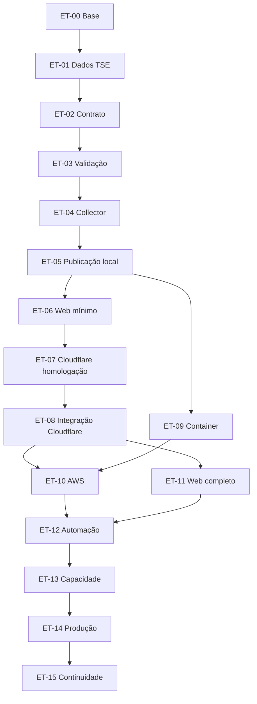

# Plano mestre

[Planejamento](README.md) · [Catálogo das etapas](etapas/README.md) · [Rastreabilidade](rastreabilidade.md) · [Decisões e riscos](decisoes-e-riscos.md) · [Contexto](../contexto.md)

Este documento define escopo, sequência, dependências, marcos e estratégia da primeira versão. O detalhamento de cada etapa está nos planos de [etapas/](etapas/README.md). O estado de cada etapa fica só no [catálogo](etapas/README.md).

Revisão de 17 de outubro de 2026. Integra o conteúdo do plano geral anterior (versão de [README.md](README.md) no commit `cb42977`). Nenhum script da aplicação, nenhuma consulta ao TSE e nenhuma fonte externa foram executados ou consultados nesta revisão.

## 1. Objetivo e escopo da primeira versão

Acompanhar os resultados oficiais do segundo turno de 2026:

- resultado presidencial nacional, pelo agregado oficial;
- resultado presidencial da UF selecionada, incluindo o Distrito Federal;
- resultado de governador somente onde a disputa for confirmada pela configuração oficial;
- mapa do Brasil com seleção de UF e caminho textual equivalente;
- atualização periódica;
- distinção visível entre carregamento, ausência de dados, falha e desatualização;
- liderança parcial nunca apresentada como eleição confirmada.

Fluxo dos resultados:

```text
TSE → collector → validação e normalização → snapshots JSON → R2/CDN → navegador
```

Fluxo do site:

```text
build do web → Cloudflare Workers Static Assets → navegador
```

Restrições que valem em todas as etapas: o navegador não consulta o TSE; o EC2 do coletor não atende visitas; atualizar dados não exige novo build; nenhuma função Worker é obrigatória na leitura; há um publicador ativo; ambientes local, homologação e produção são separados.

Stack: monorepositório pnpm; React + Vite + TypeScript + Tailwind no web; Node.js + TypeScript no coletor; Zod em `@eleicoes/validation`; Vitest; k6 para carga futura. Decisões completas em [decisoes-e-riscos.md](decisoes-e-riscos.md) (DA-01 a DA-16).

## 2. Exclusões e evoluções condicionais

Fora da primeira versão e fora de ET-00 a ET-15: API NestJS + Fastify em `apps/api`, PostgreSQL, Redis, balanceador de carga, SSE, WebSocket, filas, função Worker no caminho da leitura dos JSON e segundo coletor ativo. Também fora: Senado, deputados, municípios, cadastro de visitante, projeção, declaração própria de vencedor.

Documentar a API ([api/README.md](../api/README.md)) não autoriza implementá-la. Um componente condicional só entra com: requisito de produto que o snapshot não cumpra, comparação de custo com a alternativa estática, e teste, limite de acesso e observabilidade definidos antes da exposição. Redis ou PostgreSQL pedem estado que não caiba no arquivo; balanceador só na frente de serviço dinâmico com mais de uma instância; segundo coletor só com estratégia que impeça manifesto concorrente. Nenhuma etapa cria funcionalidade para justificar esses componentes.

## 3. Estado observado do repositório

Inspeção de arquivos em 17/10/2026, somente leitura.

| Evidência | O que se pode afirmar |
| --- | --- |
| [package.json](../../package.json), [pnpm-workspace.yaml](../../pnpm-workspace.yaml), [.nvmrc](../../.nvmrc) | pnpm 12.11.2, Node 24.22.0 declarados; workspaces `apps/*` e `packages/*`; scripts `dev:web`, `dev:collector`, `build`, `typecheck`, `lint`, `format`, `format:check`, `test` (`vitest run --passWithNoTests`) |
| [apps/web/src/App.tsx](../../apps/web/src/App.tsx) | Só o título "Eleições 2026 — ambiente inicial" |
| [apps/collector/src/index.ts](../../apps/collector/src/index.ts) | Só um `console.log`; não há coleta |
| `packages/types`, `packages/election-data`, `packages/validation` | Exportam vazio; Zod 4.6.7 em `validation`; `exports` apontam para `dist`; nenhum app depende deles |
| `apps/api`, `tests/load`, `infra/cloudflare`, `.github/workflows` | Só `.gitkeep` |
| `docs/` | Contexto, arquitetura, dados, infraestrutura, segurança, testes, padrões, API, coletor e web, todos lidos para esta revisão |
| `apps/*/dist`, `packages/*/dist` (ignorados pelo Git) | Gerados em 14/10/2026 23:07: evidência histórica de um build, não repetido |
| Shell da inspeção | `node -v` = `v18.20.8`; `pnpm` indisponível (corepack sem 12.11.2 em cache); Node 24.22.0 instalado via nvm. Requer `nvm use` (ET-00-T01) |
| Raiz | Sem `AGENTS.md`, sem `.cursor/rules/`, sem `vitest.config.*`, sem Dockerfile, sem Wrangler |

**Não verificado nesta revisão:** sucesso atual de qualquer comando; PDFs de especificação do TSE, manual JWS e artigos 264 a 269 (registrados como não lidos em [dados/README.md](../dados/README.md)); disponibilidade atual dos hosts do TSE; qualquer recurso de nuvem (não existem).

**Divergências conhecidas:** o [README da raiz](../../README.md) citava Cloudflare Pages; a decisão vigente é Workers Static Assets (DA-01), e a correção foi feita em ET-00-T05. `index.ts` × `main.ts` (COL-002) é tratado em ET-04-T14.

**Fato de calendário:** [dados/README.md](../dados/README.md) registra o segundo turno em 25/10/2026, oito dias depois desta revisão. Isso não é prazo do plano; é a decisão pendente DP-01 e o risco R-02.

## 4. Dependências

### Caminho principal

1. **Base e dados:** ET-00 confirma a base; ET-01 obtém evidência da origem; ET-02 fecha o contrato.
2. **Fluxo local:** ET-03 valida e normaliza; ET-04 coleta; ET-05 publica em disco; ET-06 mostra a tela mínima.
3. **Cloudflare:** ET-07 prepara a homologação; ET-08 faz o coletor do computador publicar no R2 e o site ler dali.
4. **Coletor independente:** ET-09 empacota; ET-10 opera na AWS.
5. **Produto:** ET-11 completa o web.
6. **Operação e prova:** ET-12 automatiza e ensaia; ET-13 mede capacidade e resiliência.
7. **Produção e depois:** ET-14 abre; ET-15 decide e executa continuidade ou encerramento.

### Grafo

Sem ciclos. A numeração é a ordem recomendada; dependência é só o que está no grafo.



### Dependências por tipo

| Etapa | Implementação | Contrato | Decisão | Recurso externo |
| --- | --- | --- | --- | --- |
| ET-00 | — | — | — | Node e pnpm declarados na máquina |
| ET-01 | ET-00 (convenção de evidências) | — | DP-01, DP-02 | Documentação oficial; arquivos publicados pelo TSE |
| ET-02 | ET-01 (matriz e amostras) | — | DP-03, DP-09, DP-11 | — |
| ET-03 | ET-00 (DP-18) | ET-02 | DP-03, DP-09 | Amostras oficiais |
| ET-04 | ET-03 | ET-02 (DP-13) | DP-04, DP-08, DP-14, DP-06 se exigido | Allowlist; autorização de coleta controlada |
| ET-05 | ET-04 (integração T10), ET-03 | ET-02 (DP-12, DP-13) | DP-20 | — |
| ET-06 | ET-05, ET-03 | ET-02 | DP-19 | — |
| ET-07 | ET-06 | ET-02 (layout para cache) | DP-21, DP-22, DP-23, DP-06, DP-07 | Conta e domínio Cloudflare |
| ET-08 | ET-07, ET-05, ET-06 | — | DP-24 | Credencial de homologação |
| ET-09 | ET-05 (ET-08 só para V10) | — | DP-18 | Docker |
| ET-10 | ET-08, ET-09 | — | DP-25, DP-22, DP-26, DP-16 | Conta AWS |
| ET-11 | ET-08 para concluir; ET-06 para começar | ET-02 | DP-29, DP-14, DP-17 | Fonte cartográfica |
| ET-12 | ET-10, ET-11 | — | DP-26, DP-23 | Repositório GitHub com ambientes |
| ET-13 | ET-12 | — | DP-28, DP-27, DP-22 | Autorização e orçamento de carga |
| ET-14 | ET-13 | — | DP-30, DP-21, DP-07, DP-31 (texto) | Domínio final; arquivos oficiais |
| ET-15 | ET-14 para executar | ET-02 (sinal de encerramento, retenção) | DP-31, DP-15 | Autorizações de parada e remoção |

### Ajustes em relação ao ponto de partida e ao plano anterior

O grafo acima é igual ao ponto de partida definido para esta revisão. As diferenças são em relação ao plano anterior:

| Etapa | Plano anterior | Agora | Justificativa |
| --- | --- | --- | --- |
| ET-05 | ET-02, ET-03 (em paralelo com ET-04) | ET-04 formal; início parcial após ET-03 | A conclusão inclui integrar coleta e publicação (ET-05-T10). As tarefas de disco (T01–T09, T11) podem começar após ET-03, sem dependência circular: ET-04 define a assinatura `publish` e testa com fake |
| ET-09 | ET-08 | ET-05 | Empacotamento, encerramento e recuperação se provam com o publicador local. A imagem é reconstruída quando o publicador R2 chega; só ET-09-V10 espera ET-08. Libera trabalho paralelo |
| ET-10 | ET-09 | ET-08 e ET-09 | Explicita que a instância precisa da imagem e do publicador R2 já provado na homologação |
| ET-11 | ET-06 para implementar; ET-08 para concluir | ET-08 formal; início parcial após ET-06 | Mesma semântica, registrada como "início parcial × conclusão" |
| ET-15 | ET-14 para executar | Igual | A política (ET-15-T01) é exigida por ET-14-T01 como decisão, não como etapa. Não há ciclo |

Os caminhos previstos de cinco documentos mudaram de nome em relação ao catálogo anterior (por exemplo, `00-base-do-projeto.md` → `00-base-e-prontidao.md`). Os antigos nunca foram criados, então não havia arquivo a preservar; ver [etapas/README.md](etapas/README.md#histórico).

## 5. Paralelismo e início parcial

Início parcial não é conclusão. Uma tela feita com fixtures não comprova integração com a publicação real; a etapa só conclui com as validações do seu plano.

| Trabalho | Pode começar | Conclusão depende de |
| --- | --- | --- |
| Leitura da documentação do TSE e classificação de JWS e resolução (ET-01-T01, T09) | Já | — |
| Decisões de envelope, disponibilidade, manifesto, versão e retenção (ET-02-T01, T02, T07–T12) | Já, sem campo da origem | ET-01 para os grupos de dados |
| Decisões de conta, plano, domínios, orçamento e ferramenta da Cloudflare (ET-07-T01–T04) | Já, sem criar recurso | Criação de recurso espera ET-06 |
| Decisões de região, tipo e orçamento da AWS (ET-10-T01) | Após a medição de ET-09-T09, ou como rascunho antes | Recurso espera ET-08 e ET-09 |
| Escolha do GeoJSON (ET-11-T01) | Já | Mapa espera ET-06 |
| Política de continuidade (ET-15-T01) | Já | Precisa existir antes de ET-14-T01 |
| Metas e cenários de carga (ET-13-T01) | Já, como texto | Execução espera ET-12 |
| Schemas de envelope e manifesto (ET-03-T03 parcial) | Com ET-02 parcial | Grupos de dados esperam ET-02 completo |
| Cliente, tentativas, agendador, encerramento, logs (ET-04-T01–T04, T06, T09–T12) | Com ET-03 em andamento | Ciclo (T08) espera ET-03 |
| Publicador em disco e simulador (ET-05-T01–T09, T11) | Após ET-03 | Integração (T10) espera ET-04 |
| Tela com fixtures (ET-06-T01–T07) | Após ET-03 | Integração (T08) espera ET-05 |
| Container (ET-09) | Após ET-05 | V10 espera ET-08 |
| Web completo (ET-11) | Após ET-06 | ET-08 para o percurso em homologação |
| Workflow mínimo de verificação (parte de ET-12-T01) | Após a primeira suíte de ET-03 | Consolidação em ET-12 |

Segurança básica, testes unitários e log mínimo acompanham cada entrega desde ET-03. ET-12 consolida; não é a primeira vez que existem.

## 6. Marcos

Os marcos estão planejados. Nenhum foi atingido nesta revisão.

| Marco | O que passa a ser verdade | Critério verificável | Etapas |
| --- | --- | --- | --- |
| M0 — Base pronta | Configuração conhecida, comandos executados, bloqueios de preparação resolvidos | ET-00-V01 a ET-00-V07, ET-00-V09, ET-00-V12 | ET-00 |
| M1 — Interpretação dos dados e contrato validados | Origem, ambientes, campos e semântica documentados com evidência; contrato publicado | ET-01-V03, ET-01-V04, ET-01-V06, ET-01-V07; ET-02-V01 a ET-02-V10 | ET-01, ET-02 |
| M2 — Fluxo local completo | Simulador → coletor → snapshot → tela, com falha e preservação do válido | ET-03-V01, ET-03-V04; ET-04-V14, ET-04-V17, ET-04-V20; ET-05-V01, ET-05-V03, ET-05-V09; ET-06-V11 | ET-03 a ET-06 |
| M3 — Caminho Cloudflare validado | Coletor local publica no R2; site de homologação lê, com cache, CORS e acesso verificados | ET-07-V02 a ET-07-V10; ET-08-V05 a ET-08-V09, ET-08-V12 | ET-07, ET-08 |
| M4 — Coletor independente do computador | Container na AWS, com logs, alertas e recuperação testada | ET-09-V06, ET-09-V07; ET-10-V03, ET-10-V05 a ET-10-V09, ET-10-V11 | ET-09, ET-10 |
| M5 — Produto funcional | Mapa, painéis, polling e estados aprovados nos cenários | ET-11-V07 a ET-11-V11, ET-11-V15 | ET-11 |
| M6 — Prontidão operacional | Automação, alertas, retornos, capacidade, custo e recuperação avaliados conforme metas aprovadas | ET-12-V06 a ET-12-V09, ET-12-V11; ET-13-V01, ET-13-V04, ET-13-V05, ET-13-V08 a ET-13-V10 | ET-12, ET-13 |
| M7 — Produção validada | Publicação controlada, verificações e operação inicial concluídas | ET-14-V01, ET-14-V03, ET-14-V04, ET-14-V06, ET-14-V09, ET-14-V10, ET-14-V12 | ET-14 |
| M8 — Continuidade ou encerramento controlado | Serviços e retenção seguem decisão explícita, sem remoção automática | ET-15-V01 a ET-15-V07 | ET-15 |

Correspondência com os marcos do plano anterior: os antigos M1 a M6 correspondem aos novos M1 a M6; o antigo M7 (continuidade) é o novo M8. M0 e M7 (produção) são novos.

M1 pode ser atingido "quanto ao formato" antes de existir resultado oficial do segundo turno, se ET-01 registrar essa lacuna. A confirmação com dado real repete ET-01-V03 e ET-03-V04 depois.

## 7. Estratégia de testes e segurança

### Níveis

| Nível | O que prova | Entra em | Não prova |
| --- | --- | --- | --- |
| Unitário | Regra isolada e determinística; relógio, aleatoriedade e rede controlados | ET-03 em diante | Rede, disco, CDN, permissão |
| Integração | Componentes reais juntos: servidor HTTP local, disco temporário | ET-04, ET-05, ET-09 | Serviço de nuvem |
| Interface | Comportamento visível e acessível no DOM | ET-06, ET-11 | Política da borda, cabeçalhos reais |
| Ponta a ponta | Percurso completo do visitante | ET-06 (manual, local), ET-11 (homologação) | Capacidade |
| Homologação | Configuração real de Cloudflare e AWS | ET-07, ET-08, ET-10, ET-11 | Volume de produção |
| Carga e resiliência | Capacidade, falhas e recuperação no cenário medido | ET-09 (reinício local), ET-13 | O TSE; números fora do cenário |
| Verificação operacional | Alertas, acessos, procedimentos | ET-10, ET-12, ET-14, ET-15 | — |

Regras: AAA e um comportamento por teste (TEST-001); vários `expect` só para o mesmo comportamento; unitário sem TSE nem credencial real (TEST-002); falha e borda junto do caminho feliz; mock não prova CDN, permissão nem transação; ausência de teste não é aprovação; nenhuma meta universal de cobertura (TEST-005). Toda validação nos planos diz o que é sucesso e o que caracteriza falha.

### Comandos

| Comando | Classe |
| --- | --- |
| `pnpm dev:web`, `pnpm dev:collector`, `pnpm build`, `pnpm typecheck`, `pnpm lint`, `pnpm format`, `pnpm format:check`, `pnpm test`, `pnpm --filter @eleicoes/collector start` | Existente e verificado por inspeção; não executado nesta tarefa |
| `pnpm test` como prova de suíte | Não serve até ET-03-T02 retirar `--passWithNoTests` |
| Execução única do coletor, simulador, servidor estático de desenvolvimento, verificação de bundle, ferramenta de retorno do manifesto | Propostos para criação futura (ET-04, ET-05, ET-06, ET-12) |
| Testes de interface, deploy de Workers, cliente R2, build de imagem, k6 | Dependentes de ferramenta ausente (ET-06, ET-07, ET-08, ET-09, ET-13) |

### Segurança durante o desenvolvimento

| Momento | Controle principal | Onde está |
| --- | --- | --- |
| ET-01 | Requisições contadas e autorizadas; parada em bloqueio; JWS e resolução classificados | ET-01-T02, T09 |
| ET-03 | Validação na fronteira sem coerção; sem mescla de objeto não confiável | SEC-001, SEC-002 |
| ET-04 | Allowlist, sem redirect, limites, log redigido | SEC-003, SEC-006, COL-004 |
| ET-05 | Caminho seguro; manifesto por último | SEC-003, SEC-007, COL-005 |
| ET-06, ET-11 | Texto como texto; nada de segredo em `VITE_*` | SEC-004, WEB-006 |
| ET-07 | Proteção básica antes da exposição; caminho alternativo desligado; credencial mínima | ET-07-T07, T10, T11 |
| ET-09, ET-10 | Segredo fora da imagem; sem porta; acesso administrativo sem SSH aberto; credencial por publicador | ET-09-T04, ET-10-T03 a T05 |
| ET-12 | Workflow com privilégio mínimo; rotação | SEC-008, ET-12-T07 |
| ET-13 | Ensaio de exposição, escopos e WAF | ET-13-T07 |

Carga nunca é direcionada ao TSE. O teto de 100 requisições por segundo por IP é limite da origem, não meta do coletor nem regra da nossa borda.

## 8. Riscos e decisões bloqueantes

Lista completa em [decisoes-e-riscos.md](decisoes-e-riscos.md). As que mais travam trabalho:

| Pendência | Bloqueia | Quem ou o que resolve |
| --- | --- | --- |
| DP-01 Alcance temporal diante da data documentada do segundo turno | Prioridade de ET-01; aceite de ET-14 | Responsável pelo produto (a designar) |
| DP-02 a DP-05 Amostras, campos, códigos e disputas | ET-02 (grupos de dados), ET-03-T04 a T08, ET-04 com origem real | ET-01 com a documentação de 2026 e o EA11 vigente |
| DP-06, DP-07 JWS e resolução | Exposição de homologação com dado oficial; ET-14 | ET-01-T09 |
| DP-12, DP-13 Forma do contrato e falha parcial | ET-03-T03, ET-05, ET-06 | ET-02 |
| DP-18 Resolução de pacotes | ET-03-T01 | ET-00-T03 |
| DP-21, DP-22 Conta, domínios, orçamento | Todo recurso de nuvem | Responsável pelo orçamento (a designar), ET-07-T01, ET-10-T01 |
| DP-25 Desenho da AWS | ET-10 | ET-10-T01 com a medição de ET-09 |
| DP-28, DP-27 Cenários e metas | ET-13 | Responsável pelo produto, ET-13-T01 |
| DP-30, DP-31 Autorização da produção e continuidade | ET-14, ET-15 | Responsáveis a designar |

Nenhuma dessas pendências bloqueia ET-00. ET-01 pode começar pela leitura de documentos. Prazos, responsáveis, orçamento, carga, intervalos, TTLs e metas de recuperação não foram inventados; cada um tem uma DP com o ponto em que é necessário.

## 9. Critérios para avançar à produção

ET-14 só publica quando, com evidência registrada:

1. M2 a M6 foram atingidos nas validações listadas na seção 6.
2. Toda DP que afeta produção está resolvida ou tem risco aceito por escrito (ET-14-T02).
3. Os deveres dos artigos 264 a 269 e a exigência de JWS estão atendidos (DP-06, DP-07).
4. Os recursos de produção são separados e as credenciais não cruzam ambientes (ET-14-V03).
5. O bucket de produção só contém dado oficial (ET-14-V04) e a configuração corresponde ao EA11 vigente (ET-14-V05).
6. A recuperação foi ensaiada com os recursos de produção (ET-14-V07).
7. A política de continuidade existe (ET-15-T01).
8. Há responsáveis pela primeira janela e critérios de interrupção escritos (ET-14-T09, T10).
9. Quem autoriza aprovou o checklist (DP-30).

Resultados simulados nunca são promovidos a produção.
